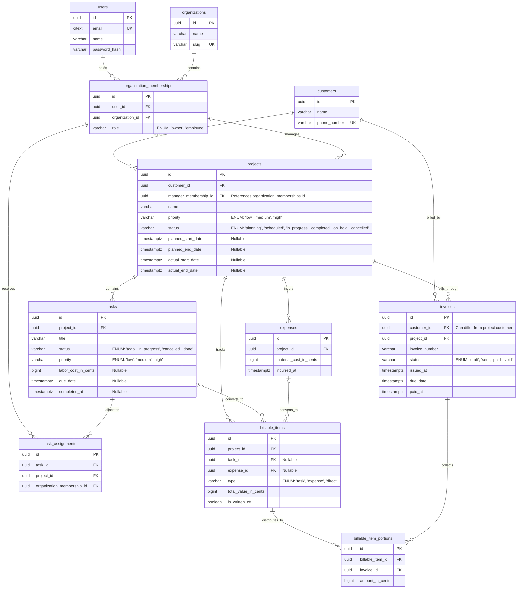

# Database Architecture

This document specifies the physical data relationships and core implementation decisions designed to support the Service Tenant ERP.

## Core Design Decisions

### Multi-Tenancy & Workspace Isolation

- **Strict Workspace Isolation via Denormalization:** Every operational record links to an Organization via a cascaded `organization_id` UUID. This guarantees data privacy while eliminating deep relational joins.

- **Global Identity:** Users maintain a single global credential profile (`UNIQUE(email)`). Access rights are isolated within an`organization_memberships` join table.

- **Unified Role-Based Access Control:** Merges all internal actors (Owners and Employees) into the `User` entity. Permissions are dynamically evaluated at runtime based on the membership role.

- **Tenant Protection:** Enforces `ON DELETE RESTRICT` on the `organizations` database to prevent cascading data loss.

- **Database-Level Isolation Boundaries:** To prevent cross-tenant data leaks, all dependent relational tables must implement **Composite Foreign Keys**. Downstream child tables must reference parent tables using a composite tuple including all common parent keys like `FOREIGN KEY (organization_id, parent_project_id, referenced_id) REFERENCES parent_table(organization_id, parent_project_id, id)`. This ensures records can never reference entities belonging to a different tenant or parent entity container.

### Financial Integrity & Audit Trails

- **Audit Preservation:** Invoices in `sent`, `paid` or `void` status are never physically deleted. Canceled transactions switch to a `void` status to maintain standard accounting history.

- **Decoupled Pricing:** Billable Items stores an independent mutable pricing. Future modifications to the source task or expense do not mutate existing generated Items.

- **Immutable Portions:** Once created, a billable portion allocated amount is frozen. This enables safe, dynamic recalculation of remaining unbilled balances. Portions can only be deleted when the invoice container status is `draft`.

### Project State Management

- **Automatic Status when re-enter Active State**: Automatically calculates project status when switching back from `on_hold` or `cancelled` to the Active State based on the existence of defined dates: `in_progress` if `actual_start_date` has value, `scheduled` if `planned_start_date` does but `actual_start_date` doesn't, and `planning` otherwise.

- **Non-Active Statuses Classification:**
  - `on_hold`: Project is paused. All tasks are filtered out of employee work queues, but the project can be reactivated at any time. Users can still create, update, or delete project's tasks, task assignments, expenses, or billable items.
  - `cancelled`: Project is discontinued. All tasks are filtered out of employee work queues, but the project can be reactivated at any time. Users cannot create, update, or delete project's tasks, task assignments, expenses, or billable items.
  - `completed`: Project is finished. All tasks are filtered out of employee work queues, and the project cannot be reactivated.

- **Terminal State Restrictions:** A `completed` status project must have a defined `actual_end_date` and cannot be reactivated to an Active state.

- **Date Preservation In State Transitions:** When a project transitions to `on_hold`, `cancelled`, or `completed` all defined dates are preserved. When reactivating, the system automatically recalculates the project status based on the existing dates.

### Modeling Conventions

- **PostgreSQL Native Engine:** Schema targets PostgreSQL natively, leveraging explicit foreign keys and optimized composite indexes for tenant-scoped lookups.

- **Physical Pluralization:** Maps documentation entities (singular) to plural lowercase PostgreSQL tables (`users`, `projects`) to prevent SQL reserved keyword collisions.

- **Diagram Optimization:** Omits operational metadata (`created_at`, `updated_at`, `archived_at`, `is_active`, `notes`, `description`, `organization_id`) from visual ERD diagrams to keep the focus strictly on core business domain boundaries.

## Entity-Relationship Diagram (ERD)

## Data Dictionary & Schema Specifications

_Note: All schema tables must implement the **Database-Level Isolation Boundaries** (Composite Foreign Keys) defined in the Core Decisions section._

### 1. `users`

Global user profile.

| Column          | PostgreSQL Type | Constraints                                                                                      | Description                                                                                                       |
| :-------------- | :-------------- | :----------------------------------------------------------------------------------------------- | :---------------------------------------------------------------------------------------------------------------- |
| `id`            | `UUID`          | `PRIMARY KEY`, `DEFAULT gen_random_uuid()`                                                       | Unique user identifier.                                                                                           |
| `email`         | `CITEXT`        | `NOT NULL`, `UNIQUE`, `CHECK (email ~* '^[a-z0-9._%+-]+@[a-z0-9-]+(\.[a-z0-9-]+)*\.[a-z]{2,}$')` | Primary login identifier. Formatted natively as a case-insensitive string with structural regex email validation. |
| `name`          | `VARCHAR(150)`  | `NOT NULL`, `CHECK(LENGTH(TRIM(name)) >= 2)`                                                     | Full display name. Prevents empty or whitespace-only names.                                                       |
| `password_hash` | `TEXT`          | `NOT NULL`                                                                                       | Hashed credential.                                                                                                |
| `created_at`    | `TIMESTAMPTZ`   | `NOT NULL`, `DEFAULT NOW()`                                                                      | Creation audit timestamp.                                                                                         |
| `updated_at`    | `TIMESTAMPTZ`   | `NOT NULL`                                                                                       | Modification audit timestamp, maintained by the application on each update.                                       |

### 2. `organizations`

Root tenant entity defining isolation boundaries.

| Column        | PostgreSQL Type | Constraints                                                        | Description                                                                                 |
| :------------ | :-------------- | :----------------------------------------------------------------- | :------------------------------------------------------------------------------------------ |
| `id`          | `UUID`          | `PRIMARY KEY`, `DEFAULT gen_random_uuid()`                         | Unique tenant identifier.                                                                   |
| `name`        | `VARCHAR(100)`  | `NOT NULL`, `CHECK(LENGTH(TRIM(name)) >= 2)`                       | Legal or display name of the business. Enforces a minimum length of 2 printable characters. |
| `slug`        | `VARCHAR(100)`  | `NOT NULL`, `UNIQUE`, `CHECK(slug ~ '^[a-z0-9]+(?:-[a-z0-9]+)*$')` | URL-safe, human-recognizable unique identifier.                                             |
| `description` | `TEXT`          | `NULLABLE`                                                         | Optional summary or overview of the organization.                                           |
| `created_at`  | `TIMESTAMPTZ`   | `NOT NULL`, `DEFAULT NOW()`                                        | Creation audit timestamp.                                                                   |
| `updated_at`  | `TIMESTAMPTZ`   | `NOT NULL`                                                         | Modification audit timestamp, maintained by the application on each update.                 |

### 3. `organization_memberships`

Junction entity controlling isolated workspace membership and access role.

| Column            | PostgreSQL Type  | Constraints                                                   | Description                                                                                               |
| :---------------- | :--------------- | :------------------------------------------------------------ | :-------------------------------------------------------------------------------------------------------- |
| `id`              | `UUID`           | `PRIMARY KEY`, `DEFAULT gen_random_uuid()`                    | Unique membership identifier.                                                                             |
| `organization_id` | `UUID`           | `NOT NULL`, `REFERENCES organizations(id) ON DELETE RESTRICT` | Associated workspace scope.                                                                               |
| `user_id`         | `UUID`           | `NOT NULL`, `REFERENCES users(id) ON DELETE RESTRICT`         | Associated global user account.                                                                           |
| `name`            | `VARCHAR(150)`   | `NOT NULL`, `CHECK(LENGTH(TRIM(name)) >= 2)`                  | Workspace-specific display name for the user profile.                                                     |
| `role`            | `MembershipRole` | `NOT NULL`                                                    | Workspace permission level. Implemented as ENUM('owner', 'employee').                                     |
| `is_active`       | `BOOLEAN`        | `NOT NULL`, `DEFAULT TRUE`                                    | Operational lifecycle flag that governs member workspace access and eligibility for new task assignments. |
| `notes`           | `TEXT`           | `NULLABLE`                                                    | Internal workspace administrative notes regarding this profile.                                           |
| `created_at`      | `TIMESTAMPTZ`    | `NOT NULL`, `DEFAULT NOW()`                                   | Creation audit timestamp.                                                                                 |
| `updated_at`      | `TIMESTAMPTZ`    | `NOT NULL`                                                    | Modification audit timestamp, maintained by the application on each update.                               |

> **Composite Constraint:** `UNIQUE (`organization_id`, `user_id`)` ensures a user account can only hold one membership profile per workspace.

### 4. `customers`

External client profiles managed by the organization.

| Column            | PostgreSQL Type | Constraints                                                   | Description                                                                                                                                                          |
| :---------------- | :-------------- | :------------------------------------------------------------ | :------------------------------------------------------------------------------------------------------------------------------------------------------------------- |
| `id`              | `UUID`          | `PRIMARY KEY`, `DEFAULT gen_random_uuid()`                    | Unique customer identifier.                                                                                                                                          |
| `organization_id` | `UUID`          | `NOT NULL`, `REFERENCES organizations(id) ON DELETE RESTRICT` | Tenant ownership key.                                                                                                                                                |
| `name`            | `VARCHAR(150)`  | `NOT NULL`, `CHECK(LENGTH(TRIM(name)) >= 2)`                  | Display or legal name of the client company. Prevents empty or whitespace-only names.                                                                                |
| `phone_number`    | `VARCHAR(30)`   | `NOT NULL`, `CHECK (phone_number ~ '^\+[1-9][0-9]{7,14}$')`   | Primary contact number. Must include a '+' followed by the country code and digits only.                                                                             |
| `notes`           | `TEXT`          | `NULLABLE`                                                    | Internal CRM notes.                                                                                                                                                  |
| `is_active`       | `BOOLEAN`       | `NOT NULL`, `DEFAULT TRUE`                                    | Operational flag defining whether this client is eligible as a target of new business actions (projects, invoices). Setting this to FALSE preserves historical data. |
| `created_at`      | `TIMESTAMPTZ`   | `NOT NULL`, `DEFAULT NOW()`                                   | Creation audit timestamp.                                                                                                                                            |
| `updated_at`      | `TIMESTAMPTZ`   | `NOT NULL`                                                    | Modification audit timestamp, maintained by the application on each update.                                                                                          |

> **Composite Constraint:** `UNIQUE (`organization_id`, `phone_number`)` prevents duplicated customer profiles from being created within the same business environment.

### 5. `projects`

Primary operation container for tasks, costs, and invoicing.

| Column                  | PostgreSQL Type   | Constraints                                                                                                                                    | Description                                                                                                        |
| :---------------------- | :---------------- | :--------------------------------------------------------------------------------------------------------------------------------------------- | :----------------------------------------------------------------------------------------------------------------- |
| `id`                    | `UUID`            | `PRIMARY KEY`, `DEFAULT gen_random_uuid()`                                                                                                     | Unique project identifier.                                                                                         |
| `organization_id`       | `UUID`            | `NOT NULL`, `REFERENCES organizations(id) ON DELETE RESTRICT`                                                                                  | Tenant ownership key.                                                                                              |
| `customer_id`           | `UUID`            | `NOT NULL`, `FOREIGN KEY (organization_id, customer_id) REFERENCES customers(organization_id, id) ON DELETE RESTRICT`                          | External client sponsoring the project.                                                                            |
| `manager_membership_id` | `UUID`            | `NOT NULL`, `FOREIGN KEY (organization_id, manager_membership_id) REFERENCES organization_memberships(organization_id, id) ON DELETE RESTRICT` | Designated internal manager (Owner or Employee).                                                                   |
| `name`                  | `VARCHAR(150)`    | `NOT NULL`, `CHECK(LENGTH(TRIM(name)) >= 2)`                                                                                                   | Project title. Ensures descriptive names.                                                                          |
| `description`           | `TEXT`            | `NULLABLE`                                                                                                                                     | Additional information on project scope, objectives and workflow.                                                  |
| `priority`              | `ProjectPriority` | `NOT NULL`                                                                                                                                     | Business urgency level in completing the project. Implemented as ENUM('low', 'medium', 'high').                    |
| `status`                | `ProjectStatus`   | `NOT NULL`                                                                                                                                     | Lifecycle state. Implemented as ENUM('planning', 'scheduled', 'in_progress', 'completed', 'on_hold', 'cancelled'). |
| `planned_start_date`    | `TIMESTAMPTZ`     | `NULLABLE`                                                                                                                                     | Baseline date when work is scheduled to begin.                                                                     |
| `planned_end_date`      | `TIMESTAMPTZ`     | `NULLABLE`                                                                                                                                     | Baseline deadline.                                                                                                 |
| `actual_start_date`     | `TIMESTAMPTZ`     | `NULLABLE`                                                                                                                                     | Timestamp when the project is kicked off (status transitions to 'in_progress').                                    |
| `actual_end_date`       | `TIMESTAMPTZ`     | `NULLABLE`                                                                                                                                     | Timestamp when the project is closed out (status transitions to 'completed').                                      |
| `created_at`            | `TIMESTAMPTZ`     | `NOT NULL`, `DEFAULT NOW()`                                                                                                                    | Creation audit timestamp.                                                                                          |
| `updated_at`            | `TIMESTAMPTZ`     | `NOT NULL`                                                                                                                                     | Modification audit timestamp, maintained by the application on each update.                                        |

> **State Consistency Check:** `Enforces valid status and defined dates combinations across the project lifecycle:

- `status = 'planning'` &rarr; `all planned_start & actual_start/end ARE NULL`
- `status = 'scheduled'` &rarr; `planned_start HAS VALUE AND actual_start/end ARE NULL`
- `status = 'in_progress'` &rarr; `actual_start HAS VALUE AND actual_end IS NULL`
- `status = 'completed'` &rarr; `actual_end HAS VALUE`
- `status = 'on_hold'` OR `status = 'cancelled'` &rarr; `actual_end IS NULL`

### 6. `tasks`

Work unit, may convert to billable items.

| Column                | PostgreSQL Type | Constraints                                                                                                          | Description                                                                            |
| :-------------------- | :-------------- | :------------------------------------------------------------------------------------------------------------------- | :------------------------------------------------------------------------------------- |
| `id`                  | `UUID`          | `PRIMARY KEY`, `DEFAULT gen_random_uuid()`                                                                           | Unique task identifier.                                                                |
| `organization_id`     | `UUID`          | `NOT NULL`, `REFERENCES organizations(id) ON DELETE RESTRICT`                                                        | Tenant ownership key.                                                                  |
| `project_id`          | `UUID`          | `NOT NULL`, `FOREIGN KEY (organization_id, project_id) REFERENCES projects(organization_id, id) ON DELETE RESTRICT ` | Parent project container.                                                              |
| `title`               | `VARCHAR(300)`  | `NOT NULL`, `CHECK(LENGTH(TRIM(title)) >= 2)`                                                                        | Short summary of the work unit.                                                        |
| `description`         | `TEXT`          | `NULLABLE`                                                                                                           | Task execution details.                                                                |
| `status`              | `TaskStatus`    | `NOT NULL`                                                                                                           | Task execution state. Implemented as ENUM('todo', 'in_progress', 'cancelled', 'done'). |
| `priority`            | `TaskPriority`  | `NOT NULL`                                                                                                           | Task urgency classification. Implemented as ENUM('low', 'medium', 'high').             |
| `labor_cost_in_cents` | `BIGINT`        | `NULLABLE`, `CHECK(labor_cost_in_cents >= 0)`                                                                        | Internal human resource cost.                                                          |
| `due_date`            | `TIMESTAMPTZ`   | `NULLABLE`                                                                                                           | Target completion date.                                                                |
| `completed_at`        | `TIMESTAMPTZ`   | `NULLABLE`                                                                                                           | Timestamp when task reach `done` state.                                                |
| `created_at`          | `TIMESTAMPTZ`   | `NOT NULL`, `DEFAULT NOW()`                                                                                          | Creation audit timestamp.                                                              |
| `updated_at`          | `TIMESTAMPTZ`   | `NOT NULL`                                                                                                           | Modification audit timestamp, maintained by the application on each update.            |

### 7. `task_assignments`

Temporal junction table linking users to tasks. Operates on an append-only pattern: assignment records are never updated or mutated after creation; except for closing via setting its unassigned_at field.

| Column            | PostgreSQL Type | Constraints                                                                                                                            | Description                              |
| :---------------- | :-------------- | :------------------------------------------------------------------------------------------------------------------------------------- | :--------------------------------------- |
| `id`              | `UUID`          | `PRIMARY KEY`, `DEFAULT gen_random_uuid()`                                                                                             | Unique assignment identifier.            |
| `organization_id` | `UUID`          | `NOT NULL`, `REFERENCES organizations(id) ON DELETE RESTRICT`                                                                          | Tenant ownership key.                    |
| `task_id`         | `UUID`          | `NOT NULL`, `FOREIGN KEY (organization_id, project_id, task_id) REFERENCES tasks(organization_id, project_id, id) ON DELETE RESTRICT`  | Assigned task.                           |
| `membership_id`   | `UUID`          | `NOT NULL`, `FOREIGN KEY (organization_id, membership_id) REFERENCES organization_memberships(organization_id, id) ON DELETE RESTRICT` | Assigned user. Immutable after creation. |
| `project_id`      | `UUID`          | `NOT NULL`, `FOREIGN KEY (organization_id, project_id) REFERENCES projects(organization_id, id) ON DELETE RESTRICT `                   | Parent project container.                |

| `assigned_at` | `TIMESTAMPTZ` | `NOT NULL`, `DEFAULT NOW()` | Timestamp when the assignment was created. |
| `unassigned_at` | `TIMESTAMPTZ` | `NULLABLE` | Timestamp when the user was unassigned (NULL means currently assigned). |

> **Composite Constraint:** `CREATE UNIQUE INDEX idx_task_assignment_unique_active_per_member_task ON task_assignments (organization_id, task_id, membership_id) WHERE unassigned_at IS NULL` guarantees that each user can have one active assignment per task at any given time.

> **Immutability Constraint:** Once an assignment is closed (`unassigned_at` is set) the record becomes read-only. Reassigning a user later requires creating a new assignment record.

### 8. `expenses`

Direct project-level cost incurred during operation.

| Column                   | PostgreSQL Type | Constraints                                                                                                         | Description                                                                 |
| :----------------------- | :-------------- | :------------------------------------------------------------------------------------------------------------------ | :-------------------------------------------------------------------------- |
| `id`                     | `UUID`          | `PRIMARY KEY`, `DEFAULT gen_random_uuid()`                                                                          | Unique expense identifier.                                                  |
| `organization_id`        | `UUID`          | `NOT NULL`, `REFERENCES organizations(id) ON DELETE RESTRICT`                                                       | Tenant ownership key.                                                       |
| `project_id`             | `UUID`          | `NOT NULL`, `FOREIGN KEY (organization_id, project_id) REFERENCES projects(organization_id, id) ON DELETE RESTRICT` | Parent project container.                                                   |
| `material_cost_in_cents` | `BIGINT`        | `NOT NULL`, `CHECK (material_cost_in_cents >= 0)`                                                                   | Cost of physical items or third-party tools.                                |
| `incurred_at`            | `TIMESTAMPTZ`   | `NOT NULL`, `DEFAULT NOW()`                                                                                         | Timestamp when the expense occurred.                                        |
| `created_at`             | `TIMESTAMPTZ`   | `NOT NULL`, `DEFAULT NOW()`                                                                                         | Creation audit timestamp.                                                   |
| `updated_at`             | `TIMESTAMPTZ`   | `NOT NULL`                                                                                                          | Modification audit timestamp, maintained by the application on each update. |

### 9. `billable_items`

Financial charge generated for client billing. Can be split across multiple invoices.

| Column                 | PostgreSQL Type    | Constraints                                                                                                                                 | Description                                                                                                                     |
| :--------------------- | :----------------- | :------------------------------------------------------------------------------------------------------------------------------------------ | :------------------------------------------------------------------------------------------------------------------------------ |
| `id`                   | `UUID`             | `PRIMARY KEY`, `DEFAULT gen_random_uuid()`                                                                                                  | Unique billable item identifier.                                                                                                |
| `description`          | `TEXT`             | `NULLABLE`                                                                                                                                  | Human-readable title or narrative of the charge. Snapshotted from tasks/expenses or entered manually for direct charges.        |
| `organization_id`      | `UUID`             | `NOT NULL`, `REFERENCES organizations(id) ON DELETE RESTRICT`                                                                               | Tenant ownership key.                                                                                                           |
| `project_id`           | `UUID`             | `NOT NULL`, `FOREIGN KEY (organization_id, project_id) REFERENCES projects(organization_id, id) ON DELETE RESTRICT`                         | Parent project container.                                                                                                       |
| `task_id`              | `UUID`             | `NULLABLE`, `FOREIGN KEY (organization_id, project_id, task_id) REFERENCES tasks(organization_id, project_id, id) ON DELETE RESTRICT`       | Source task reference.                                                                                                          |
| `expense_id`           | `UUID`             | `NULLABLE`, `FOREIGN KEY (organization_id, project_id, expense_id) REFERENCES expenses(organization_id, project_id, id) ON DELETE RESTRICT` | Source expense reference.                                                                                                       |
| `type`                 | `BillableItemType` | `NOT NULL`                                                                                                                                  | Classification of the billable item validated against its source reference. Implemented as ENUM('task', 'expense', 'direct').   |
| `total_value_in_cents` | `BIGINT`           | `NOT NULL`, `CHECK(total_value_in_cents >= 0)`                                                                                              | Amount to be charged to the client.                                                                                             |
| `is_written_off`       | `BOOLEAN`          | `NOT NULL`, `DEFAULT FALSE`                                                                                                                 | Status flag marking a billing attempt as cancelled or written off, allowing a new billable item to be generated for the source. |
| `created_at`           | `TIMESTAMPTZ`      | `NOT NULL`, `DEFAULT NOW()`                                                                                                                 | Creation audit timestamp.                                                                                                       |
| `updated_at`           | `TIMESTAMPTZ`      | `NOT NULL`                                                                                                                                  | Modification audit timestamp, maintained by the application on each update.                                                     |

> **Check Constraint:** `CHECK (task_id IS NULL OR expense_id IS NULL)` enforces that a billable item originates from only one source type (task, expense or direct charge).

> **Partial Unique Index:** `CREATE UNIQUE INDEX indx_billable_items_unique_active_task ON billable_items (task_id) WHERE is_written_off = FALSE AND task_id IS NOT NULL` ensures a task can only have one active non-written-off billable item at a time.

> **Partial Unique Index:** `CREATE UNIQUE INDEX indx_billable_items_unique_active_expense ON billable_items (expense_id) WHERE is_written_off = FALSE AND expense_id IS NOT NULL` ensures an expense can only have one active non-written-off billable item at a time.

> **Data Coherence Constraint:** `CHECK ((type = 'task' AND task_id IS NOT NULL AND expense_id IS NULL) OR (type = 'expense' AND task_id IS NULL AND expense_id IS NOT NULL) OR (type = 'direct' AND task_id IS NULL AND expense_id IS NULL))` enforces that the `type` field is consistent with the source reference columns.

### 10. `invoices`

Formal billing document issued to customers.

| Column            | PostgreSQL Type | Constraints                                                                                                           | Description                                                                                                |
| :---------------- | :-------------- | :-------------------------------------------------------------------------------------------------------------------- | :--------------------------------------------------------------------------------------------------------- |
| `id`              | `UUID`          | `PRIMARY KEY`, `DEFAULT gen_random_uuid()`                                                                            | Unique invoice identifier.                                                                                 |
| `organization_id` | `UUID`          | `NOT NULL`, `REFERENCES organizations(id) ON DELETE RESTRICT`                                                         | Tenant ownership key.                                                                                      |
| `customer_id`     | `UUID`          | `NOT NULL`, `FOREIGN KEY (organization_id, customer_id) REFERENCES customers(organization_id, id) ON DELETE RESTRICT` | Target client billed.                                                                                      |
| `project_id`      | `UUID`          | `NOT NULL`, `FOREIGN KEY (organization_id, project_id) REFERENCES projects(organization_id, id) ON DELETE RESTRICT`   | Parent associated project.                                                                                 |
| `invoice_number`  | `VARCHAR(50)`   | `NOT NULL`                                                                                                            | Unique invoice code per tenant. Autogenerated by the backend upon creation but fully editable via the API. |
| `status`          | `InvoiceStatus` | `NOT NULL`                                                                                                            | Lifecycle state. Implemented as ENUM('draft', 'sent', 'paid', 'void').                                     |
| `issued_at`       | `TIMESTAMPTZ`   | `NULLABLE`                                                                                                            | Timestamp when the invoice was sent.                                                                       |
| `due_date`        | `TIMESTAMPTZ`   | `NULLABLE`                                                                                                            | Payment due date.                                                                                          |
| `paid_at`         | `TIMESTAMPTZ`   | `NULLABLE`                                                                                                            | Timestamp when payment was confirmed.                                                                      |
| `created_at`      | `TIMESTAMPTZ`   | `NOT NULL`, `DEFAULT NOW()`                                                                                           | Creation audit timestamp.                                                                                  |
| `updated_at`      | `TIMESTAMPTZ`   | `NOT NULL`                                                                                                            | Modification audit timestamp, maintained by the application on each update.                                |

> **Composite Constraint:** `UNIQUE (organization_id, invoice_number)` guarantees unique invoice numbers per tenant organization.

> **State Consistency Check:** Enforces valid timestamp combinations across the invoice lifecycle:

- `status = 'draft'` &rarr; `issued_at IS NULL AND paid_at IS NULL`
- `status = 'sent'` &rarr; `issued_at IS NOT NULL AND paid_at IS NULL`
- `status = 'paid'` &rarr; `issued_at IS NOT NULL AND paid_at IS NOT NULL`
- `status = 'void'` &rarr; `issued_at IS NOT NULL AND paid_at IS NULL`

### 11. `billable_item_portions`

Line-item splits for billing. Links a specific dollar amount of a billable item to a specific invoice.

| Column             | PostgreSQL Type | Constraints                                                                                                                     | Description                                                                 |
| :----------------- | :-------------- | :------------------------------------------------------------------------------------------------------------------------------ | :-------------------------------------------------------------------------- |
| `id`               | `UUID`          | `PRIMARY KEY`, `DEFAULT gen_random_uuid()`                                                                                      | Unique portion identifier.                                                  |
| `organization_id`  | `UUID`          | `NOT NULL`, `REFERENCES organizations(id) ON DELETE RESTRICT`                                                                   | Tenant ownership key.                                                       |
| `billable_item_id` | `UUID`          | `NOT NULL`, `FOREIGN KEY (organization_id, billable_item_id) REFERENCES billable_items(organization_id, id) ON DELETE RESTRICT` | Parent billable item.                                                       |
| `invoice_id`       | `UUID`          | `NOT NULL`, `FOREIGN KEY (organization_id, invoice_id) REFERENCES invoices(organization_id, id) ON DELETE RESTRICT`             | Target invoice record.                                                      |
| `amount_in_cents`  | `BIGINT`        | `NOT NULL`, `CHECK(amount_in_cents > 0)`                                                                                        | Exact amount allocated to the target invoice.                               |
| `created_at`       | `TIMESTAMPTZ`   | `NOT NULL`, `DEFAULT NOW()`                                                                                                     | Creation audit timestamp.                                                   |
| `updated_at`       | `TIMESTAMPTZ`   | `NOT NULL`                                                                                                                      | Modification audit timestamp, maintained by the application on each update. |

> **Business Invariant (Use Case Layer/Trigger):** `SUM(amount_in_cents)` across all active (non-void invoice) portions belonging to a single `billable_item_id` must not exceed `billable_items.total_value_in_cents`.

> **Lifecycle & Immutability Invariant:** Rows may only be inserted or deleted while the target `invoice_id.status` is `draft`. Once created portions are completely immutable.
